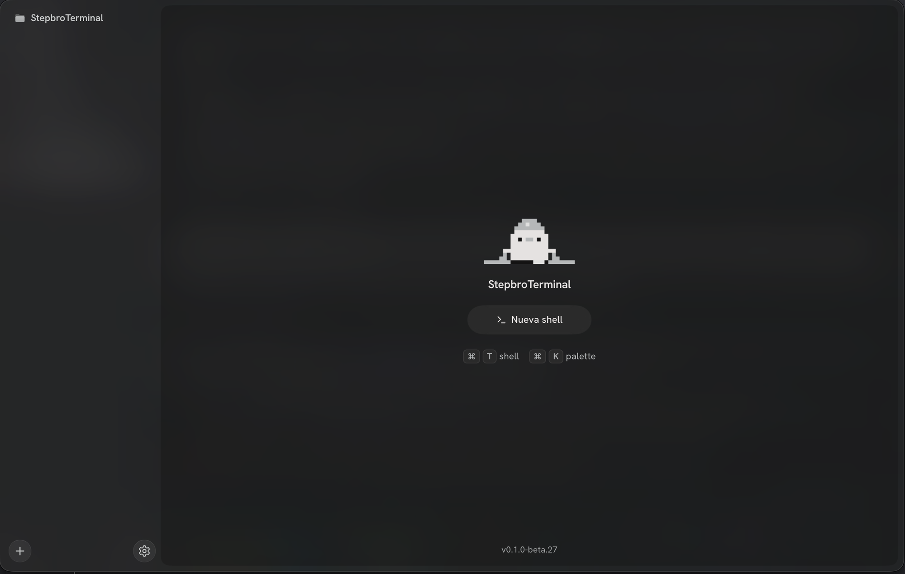

# stepbro terminal (beta)

A terminal built for running coding agents like Claude Code, Codex and OpenCode, with sessions that keep running when you close the window.

## Latest: 0.1.0-beta.29

MCP questions that call you at once, the mouse in Codex fixed, and a sidebar of frosted glass.

- **Windows**: [StepbroTerminal-0.1.0-beta.29-win-x64.exe](https://github.com/kevin9038440334/StepbroTerminal-releases/releases/download/v0.1.0-beta.29/StepbroTerminal-0.1.0-beta.29-win-x64.exe)
- **macOS (Apple Silicon)**: [StepbroTerminal-0.1.0-beta.29-mac-arm64.dmg](https://github.com/kevin9038440334/StepbroTerminal-releases/releases/download/v0.1.0-beta.29/StepbroTerminal-0.1.0-beta.29-mac-arm64.dmg)
- **macOS (Intel)**: [StepbroTerminal-0.1.0-beta.29-mac-x64.dmg](https://github.com/kevin9038440334/StepbroTerminal-releases/releases/download/v0.1.0-beta.29/StepbroTerminal-0.1.0-beta.29-mac-x64.dmg)
- **Linux**: [.deb](https://github.com/kevin9038440334/StepbroTerminal-releases/releases/download/v0.1.0-beta.29/StepbroTerminal-0.1.0-beta.29-linux-amd64.deb) for Ubuntu and Debian, [AppImage](https://github.com/kevin9038440334/StepbroTerminal-releases/releases/download/v0.1.0-beta.29/StepbroTerminal-0.1.0-beta.29-linux-x86_64.AppImage) for other distributions

On Ubuntu 23.10 and later, install the .deb: Ubuntu does not let an AppImage start the sandbox Chromium runs in, so the AppImage closes before it opens. The .deb sets up what it needs as it installs.

What changed in each version is on the [Releases](https://github.com/kevin9038440334/StepbroTerminal-releases/releases) page. Already installed? On Windows and in the AppImage the app updates itself; on macOS and with the .deb it tells you when there is a new version and brings you here.

The builds are not signed yet, so Windows and macOS warn the first time you open them. On Windows click "More info" and then "Run anyway"; on macOS right-click the app and choose "Open".

It is early and things will change. If something breaks, open an issue here and tell me what you were doing.
